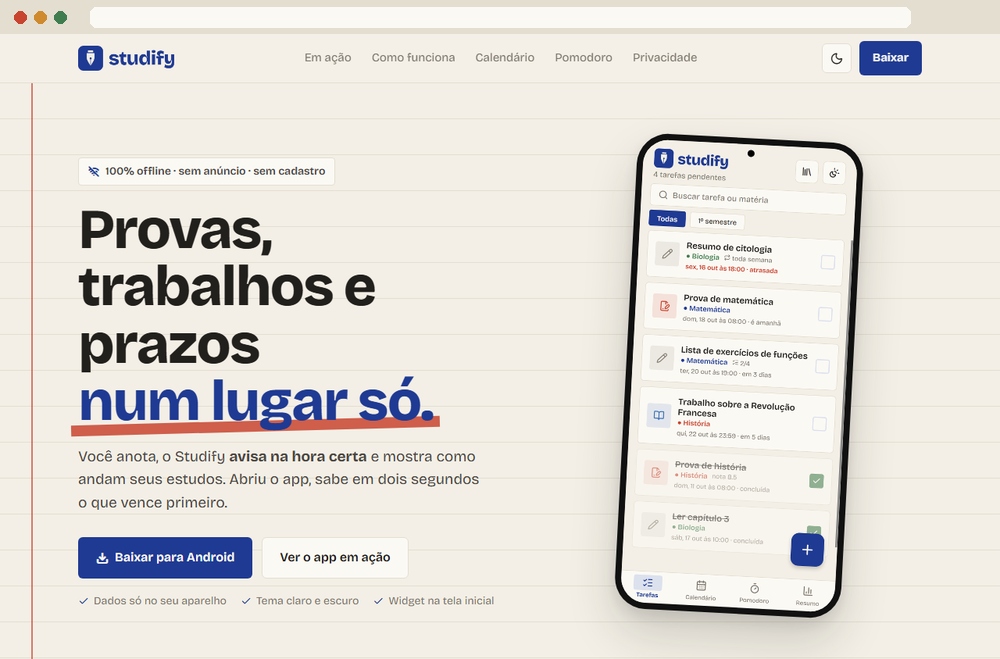
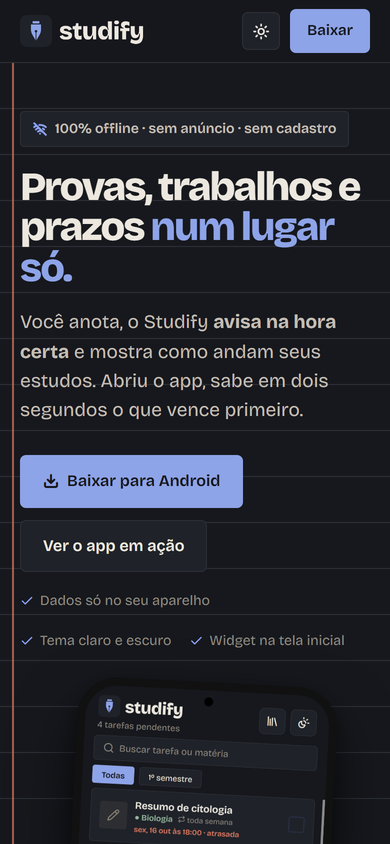

<div align="center">

<a href="https://otaviofelix-in.github.io/Studify-Site/">
<picture>
  <source media="(prefers-color-scheme: dark)" srcset="assets/readme/banner-escuro.png" />
  
</picture>
</a>

<br />

### [Abrir o site](https://otaviofelix-in.github.io/Studify-Site/) &nbsp;·&nbsp; [Baixar o APK](https://github.com/OtavioFelix-in/Studify-Site/releases/latest) &nbsp;·&nbsp; [Código do app](https://github.com/OtavioFelix-in/Studify)

<br />

[](https://otaviofelix-in.github.io/Studify-Site/)


</div>

---

## O que é

O site de apresentação do **[Studify](https://github.com/OtavioFelix-in/Studify)**, a agenda de estudos offline para Android. É onde alguém conhece o app em um minuto: vê as telas, assiste o app sendo usado e baixa o APK.

Tudo cabe em uma página só, feita com HTML e CSS na mão, sem framework, sem build e sem dependência. Abre direto do arquivo e publica pelo GitHub Pages a cada push.

<div align="center">
<br />

<br />
<sub>Do topo ao botão de download, com as seções aparecendo ao rolar</sub>
<br /><br />
</div>

---

## Por dentro da página

| Seção | O que mostra |
|---|---|
| **Topo** | A promessa do app numa frase, o botão de download e o celular com a tela de tarefas |
| **Em ação** | Quatro GIFs gravados do app de verdade: criar tarefa, concluir com confete, trocar de aba e de tema |
| **Como funciona** | Os três passos: montar as matérias, lançar provas e trabalhos, acompanhar |
| **Matérias, Calendário, Pomodoro, Resumo** | Uma seção por recurso, com o print da tela ao lado |
| **Recursos** | Lembretes, widget, repetição, fotos, backup e sincronização |
| **Galeria** | As telas principais lado a lado |
| **Privacidade** | Por que os dados ficam no celular |
| **Baixar** | O APK do último release, direto do GitHub |

---

## Claro e escuro, de verdade

O site segue o tema do sistema e tem um botão para trocar na hora. A escolha fica salva no navegador. Os prints do app trocam junto: no tema escuro, o celular mostra o app no tema escuro.

<div align="center">
<br />

<br /><br />
</div>

<table>
<tr>
<td width="50%"></td>
<td width="50%"></td>
</tr>
</table>

---

## Feito para o celular primeiro

Quem chega pelo Instagram ou pelo LinkedIn chega pelo celular. A página foi conferida em 1920, 1280, 768 e 390 px de largura, sem nada vazando para os lados.

<div align="center">
<br />

&nbsp;&nbsp;&nbsp;

<br /><br />
</div>

---

## Mesma identidade do app

O site usa as mesmas cores, fonte e ícones do Studify, definidos uma vez no topo do `style.css`.

| | Claro | Escuro |
|---|---|---|
| Fundo (papel) | `#F3EFE6` | `#16181D` |
| Tinta (cor principal) | `#1F3A93` | `#8EA4E8` |
| Margem (destaques) | `#C8442F` | `#E07A62` |
| Texto | `#22201C` | `#ECE8DF` |

- **Fonte:** [Bricolage Grotesque](https://fonts.google.com/specimen/Bricolage+Grotesque), servida junto com o site
- **Ícones:** [Lucide](https://lucide.dev), recortados para levar só os 12 que a página usa (5 KB em vez de 815 KB)
- **Fundo do topo e do final:** folha pautada com a margem vermelha, como num caderno

---

## Rodando e publicando

**Ver localmente:** abra o `index.html` no navegador. Não tem instalação nem servidor.

**Publicar:** é um push na `main`. O GitHub Pages atualiza o site em cerca de 1 minuto.

**Lançar uma versão do app:**

1. Gere o APK do Studify (instruções no [repositório do app](https://github.com/OtavioFelix-in/Studify#como-rodar))
2. Crie um release neste repositório, por exemplo `v1.1.0`
3. Anexe o arquivo com o nome exato **`Studify.apk`**

Os botões de download sempre pegam o release mais recente. O repositório e o nome do arquivo ficam no topo do `<script>` do `index.html`:

```js
var RELEASES_REPO = 'OtavioFelix-in/Studify-Site';
var APK_FILE = 'Studify.apk';
```

---

## Estrutura

```
├── index.html               # a página inteira
├── style.css                # cores, layout, tema escuro e animações
└── assets/
    ├── logo-claro.png       # logo horizontal, tema claro
    ├── logo-escuro.png      # logo horizontal, tema escuro
    ├── icon.png, favicon.png
    ├── telas/               # prints do app, claro e escuro
    ├── gifs/                # o app em uso
    ├── fontes/              # Bricolage Grotesque e ícones Lucide
    └── readme/              # imagens deste README
```

<details>
<summary><b>Quer usar um ícone novo?</b></summary>

<br />

O `Lucide-site.ttf` tem só os ícones da página. Para incluir outro, gere o arquivo de novo a partir do `Lucide.ttf` completo (vem no pacote `@react-native-vector-icons/lucide` do app), passando o código de todos os ícones usados:

```bash
pip install fonttools
pyftsubset Lucide.ttf --unicodes="U+E064,U+E06C,..." --output-file=assets/fontes/Lucide-site.ttf
```

</details>

---

<div align="center">


**[otaviofelix-in.github.io/Studify-Site](https://otaviofelix-in.github.io/Studify-Site/)**

Studify · feito por Otávio Felix

</div>
